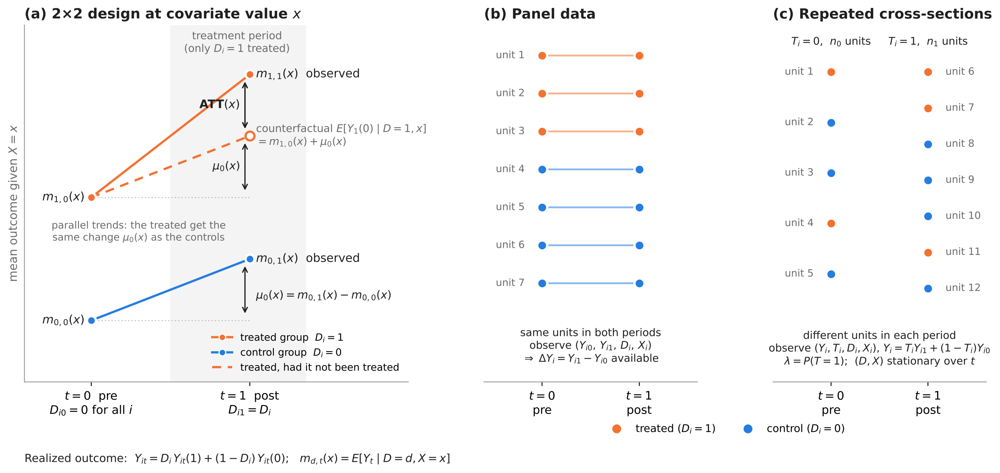

# Outcome Regression and IPW Identification of the ATT in Difference-in-Differences

*Notes on Sant'Anna and Zhao (2020), Section 2: derivations of eq. (2.2) and the IPW representations (Abadie, 2005), including eq. (2.3).*

---

## 1. Setup

Two periods $t\in\{0,1\}$. Treatment group indicator $D\in\{0,1\}$; units with $D=1$ are treated in $t=1$ only. Pre-treatment covariates $X$. Potential outcomes $Y_t(0), Y_t(1)$.

**Target parameter.**

$$
\text{ATT}=E\big[Y_1(1)-Y_1(0)\mid D=1\big].
$$

**Notation.**

| Symbol | Definition |
|---|---|
| $\Delta Y$ | $Y_1-Y_0$ (panel data only) |
| $m_{d,t}(x)$ | $E[Y_t\mid D=d,\,X=x]$ |
| $\mu_0(x)$ | $E[\Delta Y\mid D=0,\,X=x]=m_{0,1}(x)-m_{0,0}(x)$ (panel) |
| $p(x)$ | $P(D=1\mid X=x)$, the propensity score |
| $\lambda$ | $P(T=1)$, share of the pooled sample drawn in the post period (repeated cross-sections) |
| $\bar Y_{d,t}$ | sample mean of $Y$ among units with $D=d$ observed at $T=t$ |

### 1.1 The design

*Figure 1.* (a) The 2×2 design at a covariate value $x$. Nobody is treated at $t=0$ ($D_{i0}=0$ for all $i$); at $t=1$ only the treated group is treated, so $D_i\equiv D_{i1}$. The realized outcome is $Y_{it}=D_iY_{it}(1)+(1-D_i)Y_{it}(0)$. The four observed group means are $m_{d,t}(x)=E[Y_t\mid D=d,X=x]$. The control change is $\mu_0(x)=m_{0,1}(x)-m_{0,0}(x)$. The treated group's untreated post-period mean $E[Y_1(0)\mid D=1,x]$ (open circle) is the counterfactual; parallel trends draws it by giving the treated group the same change $\mu_0(x)$ (dashed line), so it equals $m_{1,0}(x)+\mu_0(x)$, and $\text{ATT}(x)$ is the vertical gap between $m_{1,1}(x)$ and that counterfactual. (b) Panel data: the same units are observed in both periods, so $\Delta Y_i=Y_{i1}-Y_{i0}$ can be formed. (c) Repeated cross-sections: each unit is observed once; $T_i=1$ if unit $i$ is observed only in the post period and $T_i=0$ if only in the pre period, $Y_i=T_iY_{i1}+(1-T_i)Y_{i0}$, and $\lambda=P(T=1)\in(0,1)$. With $n_0$ and $n_1$ units sampled in the pre and post periods, $n=n_0+n_1$ and $\lambda$ is estimated by $n_1/n$. Following Abadie (2005), covariates and treatment status are assumed stationary: the distribution of $(D,X)$ is the same in both periods.

*Notation note.* In Sant'Anna and Zhao (2020), $n_0$ and $n_1$ denote the pre- and post-period sample sizes in repeated cross-sections. Elsewhere in this report $n_1$ (and $n_{\text{treat}}$) denotes the number of treated units; the meaning is clear from context.

### 1.2 Data structures

| | Panel data | Repeated cross-sections |
|---|---|---|
| Who is observed | the same units in both periods | a new sample in each period |
| Data per unit | $(Y_{i0},Y_{i1},D_i,X_i)$ | $(Y_i,T_i,D_i,X_i)$ |
| $\Delta Y_i$ available? | yes | no |
| Example | cohort study, household panel | annual survey (CPS, BRFSS, national health surveys) |

### 1.3 Assumptions

- **A0 (no anticipation / observation rule).** $Y_0=Y_0(0)$ for all units, and $Y_1=DY_1(1)+(1-D)Y_1(0)$.
- **A1 (sampling).** i.i.d. panel; or repeated cross-sections with $T\perp(Y_0,Y_1,D,X)$ and $\lambda\in(0,1)$.
- **A2 (conditional parallel trends).**
  $$E\big[Y_1(0)-Y_0(0)\mid X,D=1\big]=E\big[Y_1(0)-Y_0(0)\mid X,D=0\big].$$
  The trend may depend on $X$ (covariate-specific trends are allowed), but given $X$ treated and controls share it (unit-specific trends that differ by treatment status are ruled out).
- **A3 (overlap).** $P(D=1)>0$ and $p(X)\le 1-\varepsilon$ for some $\varepsilon>0$.

**What is observable in A2.** The right-hand side is observable, because controls are never treated: $E[Y_1(0)-Y_0(0)\mid X,D=0]=E[Y_1-Y_0\mid X,D=0]$. On the left-hand side, $E[Y_0(0)\mid X,D=1]=E[Y_0\mid X,D=1]$ is observable by A0, but $E[Y_1(0)\mid X,D=1]$ is the counterfactual and is never observed. A2 is therefore untestable; pre-trend tests only check its analogue in earlier periods.

---

## 2. Outcome regression (OR)

### 2.1 Identification

**Step 1 (observed part).** By A0 and A1,

$$
E[Y_1(1)\mid D=1]=E[Y_1\mid D=1]=E[Y\mid D=1,T=1].
$$

**Step 2 (condition on $X$).** By iterated expectations,

$$
E[Y_1(0)\mid D=1]=E\big\{E[Y_1(0)\mid X,D=1]\,\big|\,D=1\big\}.
$$

**Step 3 (add and subtract the baseline).** For each $x$,

$$
E[Y_1(0)\mid x,D=1]=\underbrace{E[Y_0(0)\mid x,D=1]}_{(a)}+\underbrace{\big\{E[Y_1(0)\mid x,D=1]-E[Y_0(0)\mid x,D=1]\big\}}_{(b)}.
$$

**Step 4 (make each piece observable).**

- (a) By A0, $E[Y_0(0)\mid x,D=1]=m_{1,0}(x)$.
- (b) By A2, and because $Y_t=Y_t(0)$ for controls, (b) $=m_{0,1}(x)-m_{0,0}(x)$.
- A3 guarantees that $m_{0,t}(x)$ is defined wherever treated units have support.

**Why overlap (A3) is needed.** $m_{0,t}(x)=E[Y_t\mid D=0,X=x]$ is the average outcome among control units with covariates $x$. It is defined only if such controls exist:

$$
P(D=0,\,X=x)>0\iff 1-p(x)>0\iff p(x)<1.
$$

Because the ATT averages $m_{0,1}(X)-m_{0,0}(X)$ over the treated covariate distribution, $m_{0,t}$ must be defined at every $x$ where treated units exist. If, say, every unit aged 80+ is treated, the data say nothing about how untreated 80+ outcomes evolve; a fitted $\hat\mu_{0,t}$ would still return a number there, but only by extrapolating its functional form from younger controls. Only one side is needed: control-only covariate regions get zero weight in the ATT, so $p(x)>0$ is not required (the ATE would require both).

**The four functions $m_{d,t}$ are group means, not a unit's potential outcomes.** With overlap on both sides, all four can be evaluated at any $x_i$, but each describes the factual outcomes of its own group:

| Function | Equals | Meaning |
|---|---|---|
| $m_{1,1}(x)$ | $E[Y_1(1)\mid D=1,x]$ | treated, post (factual) |
| $m_{1,0}(x)$ | $E[Y_0(0)\mid D=1,x]$ | treated, pre (factual) |
| $m_{0,1}(x)$ | $E[Y_1(0)\mid D=0,x]$ | control, post (factual) |
| $m_{0,0}(x)$ | $E[Y_0(0)\mid D=0,x]$ | control, pre (factual) |

The quantity needed, $E[Y_1(0)\mid D=1,x]$, is none of the four.

**Why $m_{0,1}(x)$ is not the treated counterfactual in DID.** Cross-sectional g-computation assumes no unmeasured confounding (equal untreated *levels* given $x$) and would set $E[Y_1(0)\mid D=1,x]=m_{0,1}(x)$. DID assumes only equal *trends*, so treated and controls may differ in level, for example through an unmeasured time-invariant factor. The counterfactual is therefore built from the treated group's own baseline plus the control change:

$$
E[Y_1(0)\mid D=1,x]=\underbrace{m_{1,0}(x)}_{\text{treated baseline}}+\underbrace{m_{0,1}(x)-m_{0,0}(x)}_{\text{control trend}}.
$$

*Example at one $x$:* $m_{1,0}=50$, $m_{0,0}=40$, $m_{0,1}=45$, $m_{1,1}=60$.

| | Counterfactual $E[Y_1(0)\mid D=1,x]$ | ATT at $x$ |
|---|---|---|
| DID | $50+(45-40)=55$ | $60-55=5$ |
| Plugging in $m_{0,1}(x)$ | $45$ | $15$ |

Plugging in $m_{0,1}(x)$ ignores that the treated started 10 units higher. For the ATE one would also need $E[Y_1(1)\mid D=0,x]$, which no $m_{d,t}$ identifies without an extra assumption (e.g. the same effect for treated and controls given $X$); together with one-sided overlap, this is why DID targets the ATT.

**Step 5 (average over the treated covariate distribution).** Since $E[m_{1,0}(X)\mid D=1]=E[Y_0\mid D=1]$,

$$
E[Y_1(0)\mid D=1]=E[Y_0\mid D=1]+E\big[m_{0,1}(X)-m_{0,0}(X)\,\big|\,D=1\big].
$$

**Step 6 (combine).**

$$
\boxed{\;\text{ATT}=E[Y\mid D=1,T=1]-\Big\{E[Y\mid D=1,T=0]+E\big[m_{0,1}(X)-m_{0,0}(X)\mid D=1\big]\Big\}\;}
$$

With panel data, $m_{0,1}(x)-m_{0,0}(x)=\mu_0(x)$, so

$$
\text{ATT}=E[\Delta Y\mid D=1]-E[\mu_0(X)\mid D=1].
$$

**Interpretation of $\mu_0$.** $\mu_0(x)$ is the average untreated change among controls with covariates $x$. $E[\mu_0(X)\mid D=1]$ is that control trend reweighted to the treated covariate mix. It is observable (given overlap), but it equals the true counterfactual change $E[\Delta Y(0)\mid D=1]$ only under A2.

*Example.* If $\mu_0(\text{young})=0.05$, $\mu_0(\text{old})=0.20$, the treated are 80% young and the controls 80% old, then the treated counterfactual trend is $0.8(0.05)+0.2(0.20)=0.08$, whereas the raw control trend is $0.2(0.05)+0.8(0.20)=0.17$. Unadjusted DID would understate the ATT by $0.09$.

### 2.2 Estimator: eq. (2.2) of Sant'Anna and Zhao (2020)

Replace each population term by its sample analogue:

| Population term | Sample analogue | Computed from |
|---|---|---|
| $E[Y\mid D=1,T=1]$ | $\bar Y_{1,1}$ | treated units at $T=1$ |
| $E[Y\mid D=1,T=0]$ | $\bar Y_{1,0}$ | treated units at $T=0$ |
| $m_{0,t}(x)$ | $\hat\mu_{0,t}(x)$ | regression of $Y$ on $X$ among controls at $T=t$ |
| $E[g(X)\mid D=1]$ | $n_{\text{treat}}^{-1}\sum_{i:D_i=1}g(X_i)$ | treated units from both periods |

$$
\hat\tau^{\text{reg}}=\bar Y_{1,1}-\Big[\bar Y_{1,0}+\frac{1}{n_{\text{treat}}}\sum_{i:D_i=1}\big(\hat\mu_{0,1}(X_i)-\hat\mu_{0,0}(X_i)\big)\Big].
$$

The bracket is the estimated counterfactual $E[Y_1(0)\mid D=1]$: the treated pre-period mean plus the control trend evaluated at the treated units' covariates. Pooling the treated units of both periods in the sum is valid only because A1 makes $X\mid D=1$ the same in both periods.

**Panel version.**

$$
\hat\tau^{\text{reg}}=\frac{1}{n_1}\sum_{i:D_i=1}\big\{\Delta Y_i-\hat\mu_0(X_i)\big\},
$$

i.e. impute each treated unit's untreated outcome as $\hat Y_{i1}(0)=Y_{i0}+\hat\mu_0(X_i)$ (its own baseline plus the predicted control change) and average $Y_{i1}-\hat Y_{i1}(0)$ over the treated.

**Linear special case.** If $\hat\mu_{0,t}(x)=x^\top\hat\beta_{0,t}$ (with intercept),

$$
\hat\tau^{\text{reg}}=(\bar Y_{1,1}-\bar Y_{1,0})-\bar X_1^\top\big(\hat\beta_{0,1}-\hat\beta_{0,0}\big),
$$

where $\bar X_1$ is the treated covariate mean.

**No covariates.** $\hat\mu_{0,t}=\bar Y_{0,t}$ and $\hat\tau^{\text{reg}}=(\bar Y_{1,1}-\bar Y_{1,0})-(\bar Y_{0,1}-\bar Y_{0,0})$, the usual 2×2 DID.

### 2.3 Consistency

$\bar Y_{1,t}\to_p E[Y\mid D=1,T=t]$ by the law of large numbers. For the regression term,

$$
\frac{1}{n_{\text{treat}}}\sum_{D_i=1}\hat\mu_{0,t}(X_i)
=\underbrace{\frac{1}{n_{\text{treat}}}\sum_{D_i=1}m_{0,t}(X_i)}_{\to_p\,E[m_{0,t}(X)\mid D=1]}
+\underbrace{\frac{1}{n_{\text{treat}}}\sum_{D_i=1}\{\hat\mu_{0,t}-m_{0,t}\}(X_i)}_{\to_p\,0\ \text{if }\hat\mu_{0,t}\to m_{0,t}\text{ uniformly}}.
$$

So $\hat\tau^{\text{reg}}\to_p\text{ATT}$ when the outcome model is correctly specified. Under misspecification the second term converges to a nonzero bias.

### 2.4 How OR-DID differs from cross-sectional g-computation

| | Cross-sectional g-computation | OR-DID |
|---|---|---|
| Model fitted on | all units, $Y\sim Z+X(+Z{:}X)$ | controls only, $\Delta Y\sim X$ (or $Y\sim X$ per period) |
| Imputed for ATT | $\hat Y_i(0)=\hat E[Y\mid Z=0,X_i]$ (a level) | $\hat Y_{i1}(0)=Y_{i0}+\hat\mu_0(X_i)$ (baseline + trend) |
| Identifying assumption | no unmeasured confounding | conditional parallel trends |
| Level differences between groups | not allowed | allowed |

Fitting on controls only is equivalent to the $Z=0$ part of a fully interacted model $Y\sim Z+X+Z{:}X$.

---

## 3. Inverse probability weighting (IPW)

### 3.1 Panel data

**Claim (Abadie, 2005).**

$$
\tau:=\frac{1}{E[D]}\,E\!\left[\frac{D-p(X)}{1-p(X)}\,\Delta Y\right]=\text{ATT}.
$$

**Which expectations.** $E[D]=P(D=1)$ is the expectation of $D$ alone, a constant. The outer $E[\cdot]$ averages the random quantity $W=\frac{D-p(X)}{1-p(X)}\Delta Y$ over the joint distribution of $(D,X,\Delta Y)$, i.e. over treated and controls together.

**Step 1 (split the weight).**

$$
\frac{D-p}{1-p}=D-\frac{(1-D)\,p}{1-p},
$$

since $\dfrac{D(1-p)-(1-D)p}{1-p}=\dfrac{D-Dp-p+Dp}{1-p}=\dfrac{D-p}{1-p}$. Hence

$$
E\!\left[\frac{D-p(X)}{1-p(X)}\Delta Y\right]=\underbrace{E[D\,\Delta Y]}_{(\mathrm{I})}-\underbrace{E\!\left[\frac{(1-D)\,p(X)}{1-p(X)}\,\Delta Y\right]}_{(\mathrm{II})}.
$$

**Why this weight?** The weight $\frac{D-p(X)}{1-p(X)}$ is not an arbitrary choice; it follows from what the ATT formula needs. Three views:

*1. A change of measure for the controls.* The first term of $\text{ATT}=E[\Delta Y\mid D=1]-E[\mu_0(X)\mid D=1]$ is a plain average over the treated, so treated units get weight $1$. The second term is the problem: controls' $\Delta Y$ is observed only at the control covariate distribution $f(x\mid D=0)$, but it is needed at the treated distribution $f(x\mid D=1)$. Importance sampling reweights each control by the density ratio,

$$
E[\mu_0(X)\mid D=1]=E\!\left[\frac{f(X\mid1)}{f(X\mid0)}\,\Delta Y\;\Big|\;D=0\right],
\qquad
\frac{f(x\mid1)}{f(x\mid0)}=\frac{p(x)}{1-p(x)}\cdot\frac{P(D=0)}{P(D=1)}\quad\text{(Bayes)}.
$$

*Derivation of the change of measure.*

- *Definition of conditional expectation:* $E[\mu_0(X)\mid D=1]=\displaystyle\int\mu_0(x)\,f(x\mid1)\,dx$.
- *Multiply and divide by $f(x\mid0)$:*
  $$
  \int\mu_0(x)\,\frac{f(x\mid1)}{f(x\mid0)}\,f(x\mid0)\,dx=E\big[\mu_0(X)\,w(X)\mid D=0\big],\qquad w(x)=\frac{f(x\mid1)}{f(x\mid0)} .
  $$
  The integral is now an expectation under the control distribution. Dividing requires $f(x\mid0)>0$ wherever $f(x\mid1)>0$: controls must exist wherever treated units exist (overlap, A3).
- *Iterated expectations:* since $\mu_0(X)=E[\Delta Y\mid X,D=0]$ and $w(X)$ is a function of $X$,
  $$
  E[\mu_0(X)\,w(X)\mid D=0]=E\big[E[w(X)\,\Delta Y\mid X,D=0]\mid D=0\big]=E[w(X)\,\Delta Y\mid D=0].
  $$
  So $\mu_0$ itself is never needed: the controls' raw $\Delta Y$, weighted by $w$, gives the same answer.
- *Bayes' rule:* since $f(x\mid d)=P(D=d\mid x)\,f(x)/P(D=d)$,
  $$
  w(x)=\frac{p(x)\,f(x)/P(D=1)}{\{1-p(x)\}\,f(x)/P(D=0)}=\frac{p(x)}{1-p(x)}\cdot\frac{P(D=0)}{P(D=1)} .
  $$
- *Link to (II):* writing the control-only expectation over all units, $E[\,\cdot\mid D=0]=E[(1-D)\,\cdot\,]/P(D=0)$,
  $$
  E[w(X)\,\Delta Y\mid D=0]=\frac{1}{P(D=1)}\,E\!\left[\frac{(1-D)\,p(X)}{1-p(X)}\,\Delta Y\right]=\frac{(\mathrm{II})}{E[D]} .
  $$
  The constant $P(D=0)/P(D=1)$ cancels, which is why only the odds $p/(1-p)$ appear in the IPW weight.

*Example.* Treated 80% young / 20% old; controls 20% young / 80% old.

| | $f(x\mid1)$ | $f(x\mid0)$ | $w(x)$ | $\mu_0(x)$ |
|---|---|---|---|---|
| Young | 0.8 | 0.2 | 4 | 0.05 |
| Old | 0.2 | 0.8 | 0.25 | 0.20 |

Left side: $0.8(0.05)+0.2(0.20)=0.08$. Right side (weighted control average): $0.2\cdot4\cdot0.05+0.8\cdot0.25\cdot0.20=0.04+0.04=0.08$. The unweighted control average $0.2(0.05)+0.8(0.20)=0.17$ is wrong. The weight boosts young controls (rare among controls, common among treated) and shrinks old ones, so the controls represent the treated group's age mix. In counts (100 treated, 100 controls, so $P(D=0)/P(D=1)=1$ and $w$ equals the odds $p/(1-p)$ with $p(\text{young})=0.8$, $p(\text{old})=0.2$): the 20 young controls count as $20\times4=80$ and the 80 old controls as $80\times0.25=20$, exactly the treated mix of 80 young and 20 old.

*2. Combining both terms gives one weight.* Treated units get $+1$; controls get $-\,p/(1-p)$, negative because the counterfactual trend is subtracted:

$$
D\cdot1-(1-D)\,\frac{p(X)}{1-p(X)}=\frac{D-p(X)}{1-p(X)}.
$$

| Target population | Treated weight | Control weight |
|---|---|---|
| Everyone (ATE) | $1/p(X)$ | $1/\{1-p(X)\}$ |
| Treated (ATT) | $1$ | $p(X)/\{1-p(X)\}$ |

For the ATT the treated already are the target population, so they need no reweighting. Controls are first reweighted to the whole population, by $1/(1-p)$, and then to its treated part, by a further factor $p$.

*3. It has mean zero given $X$, which is why the common trend cancels.*

$$
E\!\left[\frac{D-p(X)}{1-p(X)}\;\Big|\;X\right]=\frac{p(X)-p(X)}{1-p(X)}=0
\quad\Longrightarrow\quad
E\!\left[\frac{D-p(X)}{1-p(X)}\,h(X)\right]=0\ \text{ for any } h .
$$

The weight removes anything that depends only on $X$. This gives a two-line proof of the IPW identity. Write $\Delta Y=\Delta Y(0)+D\{Y_1(1)-Y_1(0)\}$. Under A2, $E[\Delta Y(0)\mid X,D]=\mu_0(X)$ does not depend on $D$, so

- natural-trend part: $E\big[\tfrac{D-p}{1-p}\,\Delta Y(0)\big]=E\big[\mu_0(X)\,E[\tfrac{D-p}{1-p}\mid X]\big]=0$, i.e. the common trend is removed;
- effect part: $E\big[\tfrac{D-p}{1-p}\,D\{Y_1(1)-Y_1(0)\}\big]=E\big[D\{Y_1(1)-Y_1(0)\}\big]=E[D]\cdot\text{ATT}$, because the weight equals $1$ on the treated.

Dividing by $E[D]$ gives the ATT. In short, $(D-p)/(1-p)$ is the weight that equals $1$ on the treated and averages to zero within every covariate stratum: it removes the natural trend shared by treated and controls with the same $X$ and keeps only the effect on the treated.

**Step 2 (treated term).**

$$
(\mathrm{I})=P(D=1)\,E[\Delta Y\mid D=1]=E[D]\,E[\Delta Y\mid D=1].
$$

**Step 3 (reweighted control term).** Condition on $X$:

$$
(\mathrm{II})=E\!\left[\frac{p(X)}{1-p(X)}\,E[(1-D)\Delta Y\mid X]\right],
\qquad
E[(1-D)\Delta Y\mid X]=\{1-p(X)\}\,\mu_0(X).
$$

The factors $1-p(X)$ cancel (overlap, A3, is used here):

$$
(\mathrm{II})=E[p(X)\,\mu_0(X)]=E\big[E[D\mid X]\,\mu_0(X)\big]=E[D\,\mu_0(X)]=E[D]\,E[\mu_0(X)\mid D=1].
$$

**Detailed derivation of (I) and (II) from the definition of expectation.** Take $D\in\{0,1\}$ discrete and $(X,\Delta Y)$ with a joint density (sums replace integrals if discrete); all expectations are assumed finite. The split $E[\cdot]=(\mathrm{I})-(\mathrm{II})$ itself is linearity of expectation, $E[A-B]=E[A]-E[B]$.

*Term (I), three equivalent routes.*

1. *Definition over the joint distribution.* For any $g$, $E[g(D,\Delta Y)]=\sum_{d\in\{0,1\}}\int g(d,y)\,f_{D,\Delta Y}(d,y)\,dy$. With $g(d,y)=d\,y$ the $d=0$ term vanishes, and $f_{D,\Delta Y}(1,y)=P(D=1)\,f_{\Delta Y\mid D}(y\mid1)$:
   $$
   E[D\,\Delta Y]=\int y\,f_{D,\Delta Y}(1,y)\,dy=P(D=1)\int y\,f_{\Delta Y\mid D}(y\mid1)\,dy=P(D=1)\,E[\Delta Y\mid D=1].
   $$
2. *Law of total expectation over $D$.*
   $$
   E[D\,\Delta Y]=E[1\cdot\Delta Y\mid D=1]\,P(D=1)+E[0\cdot\Delta Y\mid D=0]\,P(D=0)=P(D=1)\,E[\Delta Y\mid D=1].
   $$
3. *Indicator.* Since $D=\mathbf 1\{D=1\}$, the definition $E[\Delta Y\mid D=1]:=E[\Delta Y\,\mathbf 1\{D=1\}]/P(D=1)$ rearranges to the same identity.

Finally $E[D]=0\cdot P(D=0)+1\cdot P(D=1)=P(D=1)$, so $(\mathrm{I})=E[D]\,E[\Delta Y\mid D=1]$.

*Caution: (I) is not $E[\Delta Y\mid D=1]$.* It is $E[\Delta Y\mid D=1]$ multiplied by the treated share, because $E[D\,\Delta Y]$ averages over all units and controls contribute $0$. Dividing by $E[D]$ recovers the treated mean, which is why $1/E[D]$ appears in front of the IPW formula. Example: 10 units, 3 treated with $\Delta Y=5$, 7 controls with $\Delta Y=2$. Then $E[D\,\Delta Y]=(5+5+5)/10=1.5$, $E[\Delta Y\mid D=1]=5$, $P(D=1)=0.3$, and $1.5/0.3=5$. The sample analogue is

$$
\frac1n\sum_{i=1}^nD_i\,\Delta Y_i=\underbrace{\frac{n_1}{n}}_{\approx P(D=1)}\cdot\underbrace{\frac{1}{n_1}\sum_{i:D_i=1}\Delta Y_i}_{\approx E[\Delta Y\mid D=1]},\qquad n_1=\sum_iD_i .
$$

*Term (II).* With $g(d,x,y)=(1-d)\,\frac{p(x)}{1-p(x)}\,y$ and the factorization $f_{D,X,\Delta Y}(d,x,y)=f_X(x)\,P(D=d\mid x)\,f_{\Delta Y\mid D,X}(y\mid d,x)$, only $d=0$ survives, and $P(D=0\mid x)=1-p(x)$:

$$
(\mathrm{II})=\int\!\!\int\frac{p(x)}{1-p(x)}\,y\,f_X(x)\{1-p(x)\}\,f_{\Delta Y\mid D,X}(y\mid0,x)\,dy\,dx=\int p(x)\,\mu_0(x)\,f_X(x)\,dx ,
$$

where the factors $1-p(x)$ cancel (overlap) and the inner integral is $\mu_0(x)$. By Bayes' rule, $p(x)\,f_X(x)=P(D=1)\,f_{X\mid D}(x\mid1)$, so

$$
(\mathrm{II})=P(D=1)\int\mu_0(x)\,f_{X\mid D}(x\mid1)\,dx=E[D]\,E[\mu_0(X)\mid D=1].
$$

This Bayes step is the same change of measure as in view 1 of *Why this weight?*.

**Step 4 (combine).**

$$
\tau=\frac{(\mathrm{I})-(\mathrm{II})}{E[D]}=E[\Delta Y\mid D=1]-E[\mu_0(X)\mid D=1].
$$

**Step 5 (equals the ATT).** By A0, $E[\Delta Y\mid D=1]=E[Y_1(1)-Y_0(0)\mid D=1]$. By A2, $\mu_0(X)=E[\Delta Y(0)\mid X,D=1]$, so $E[\mu_0(X)\mid D=1]=E[Y_1(0)-Y_0(0)\mid D=1]$. Subtracting,

$$
\tau=E[Y_1(1)-Y_1(0)\mid D=1]=\text{ATT}.\qquad\blacksquare
$$

Step 4 shows that the IPW and OR representations are the same population quantity: IPW obtains $E[\mu_0(X)\mid D=1]$ by reweighting controls rather than by modelling $\mu_0$.

**Practical meaning of Steps 2–4.**

- **Term (I): the treated group's observed change.** Multiplying by $D$ drops every control unit, so (I) is the average change $Y_1-Y_0$ among the treated, scaled by the treated share. It mixes the treatment effect with the natural trend the treated group would have followed anyway.
- **Term (II): controls reweighted to resemble the treated.** Each control's change gets the odds weight $p(X)/\{1-p(X)\}$. Controls that resemble treated units (high $p(X)$) get large weights; controls unlike any treated unit ($p(X)\approx0$) get weights near zero. The weighted controls have the treated covariate mix (see the example under view 1 of *Why this weight?*), and their average change estimates the treated group's natural trend.
- **(I) − (II): the ATT.** The observed change of the treated minus the change of similar controls removes the natural trend and leaves the treatment effect.

*Practical consequences.*

1. **No outcome model is needed.** Only a propensity model (e.g. a logistic regression of $D$ on $X$) is fitted; $\mu_0$ cancels in Step 3.
2. **Overlap matters in practice.** If $p(X)$ is close to 1 for some treated units, a few controls receive very large weights and the estimate becomes unstable. Inspect the distribution of $\hat p(X)$, consider trimming or the normalized weights (Section 3.3), and check covariate balance after weighting.
3. **A misspecified propensity model gives bias.** The weighted controls then do not match the treated covariate mix. Doubly robust DID guards against this by also modelling the outcome.

### 3.2 Repeated cross-sections: eq. (2.3)

**Claim.**

$$
\tau:=\frac{1}{E[D]}\,E\!\left[\frac{D-p(X)}{1-p(X)}\cdot\frac{T-\lambda}{\lambda(1-\lambda)}\,Y\right]=\text{ATT}.
$$

**Step 1 (split the time weight).**

$$
\frac{T-\lambda}{\lambda(1-\lambda)}\,Y=\frac{T\,Y_1}{\lambda}-\frac{(1-T)\,Y_0}{1-\lambda}.
$$

Check: if $T=1$ the left side is $\frac{1-\lambda}{\lambda(1-\lambda)}Y_1=Y_1/\lambda$; if $T=0$ it is $\frac{-\lambda}{\lambda(1-\lambda)}Y_0=-Y_0/(1-\lambda)$.

**Step 2 (independence of $T$).** Let $g=\frac{D-p(X)}{1-p(X)}$, a function of $(D,X)$ only. Since $T\perp(Y_0,Y_1,D,X)$,

$$
E\!\left[g\,\frac{T\,Y_1}{\lambda}\right]=\frac{E[T]\,E[g\,Y_1]}{\lambda}=E[g\,Y_1],
\qquad
E\!\left[g\,\frac{(1-T)\,Y_0}{1-\lambda}\right]=E[g\,Y_0].
$$

Therefore

$$
E\!\left[g\,\frac{T-\lambda}{\lambda(1-\lambda)}\,Y\right]=E\big[g\,(Y_1-Y_0)\big]=E\!\left[\frac{D-p(X)}{1-p(X)}\,\Delta Y\right].
$$

**Step 3.** This is the panel expression, so Section 3.1 gives $\tau=\text{ATT}$. $\blacksquare$

The factor $(T-\lambda)/\{\lambda(1-\lambda)\}$ rebuilds the time difference from units seen in only one period: post-period units get weight $1/\lambda$, pre-period units get weight $-1/(1-\lambda)$.

### 3.3 Estimators

**Horvitz–Thompson type (Abadie, 2005), panel.**

$$
\hat\tau^{\text{ipw}}=\frac{1}{\bar D}\cdot\frac{1}{n}\sum_{i=1}^{n}\frac{D_i-\hat p(X_i)}{1-\hat p(X_i)}\,\Delta Y_i,\qquad \bar D=\frac{1}{n}\sum_{i=1}^n D_i.
$$

Treated units enter with weight $1$; controls with weight $-\hat p/(1-\hat p)$.

**Normalized (Hájek) version.** The control weights average to $E[D]$, since $E\big[(1-D)\,p(X)/\{1-p(X)\}\big]=E[p(X)]=E[D]$, so one may normalize them to sum to one:

$$
\hat\tau^{\text{ipw,n}}=\overline{\Delta Y}_{D=1}-\frac{\sum_{i:D_i=0}w_i\,\Delta Y_i}{\sum_{i:D_i=0}w_i},\qquad w_i=\frac{\hat p(X_i)}{1-\hat p(X_i)}.
$$

This is more stable in finite samples.

**Repeated cross-sections.** Replace $\Delta Y_i$ by $\frac{T_i-\hat\lambda}{\hat\lambda(1-\hat\lambda)}Y_i$, with $\hat\lambda=n^{-1}\sum_i T_i$.

---

## 4. Relations between the estimators

| Estimator | Models | Consistent for ATT if |
|---|---|---|
| OR | $m_{0,t}(X)$ or $\mu_0(X)$ | A0–A3 and outcome model correct |
| IPW | $p(X)$ | A0–A3 and propensity model correct |
| DR (Sant'Anna and Zhao, 2020) | both | A0–A3 and either model correct |
| Nonparametric (stratified) | none | A0–A3; slower rate for continuous $X$ |

**Saturated models.** For discrete $X$, a model is saturated if it has one parameter per cell $(d,x)$, i.e. per subgroup of units sharing treatment group $d$ and covariate value $x$. Then $\hat\mu_0(x)=\overline{\Delta Y}_{0x}$ and $\hat p(x)=n_{1x}/n_x$, and OR, normalized IPW, DR and the stratified estimator

$$
\hat\tau^{\text{NP}}=\sum_x\frac{n_{1x}}{n_1}\big(\overline{\Delta Y}_{1x}-\overline{\Delta Y}_{0x}\big)
$$

are numerically identical. Saturation removes misspecification (an estimation issue) but does not relax A2 (an identification issue).

**Implication for sensitivity analysis.** Without A2, all four estimators (with correct or saturated nuisance models) converge to the same limit

$$
\theta=\text{ATT}+E[\delta(X)\mid D=1],\qquad
\delta(x)=E[\Delta Y(0)\mid x,D=1]-E[\Delta Y(0)\mid x,D=0],
$$

so a single restriction $\delta\in\Delta$ yields the same identified set

$$
\text{ATT}\in\Big[\theta-\sup_{\delta\in\Delta}E[\delta(X)\mid D=1],\;\theta-\inf_{\delta\in\Delta}E[\delta(X)\mid D=1]\Big]
$$

for OR, IPW, DR and the nonparametric estimator.

---

## References

- Abadie, A. (2005). Semiparametric difference-in-differences estimators. *Review of Economic Studies*, 72, 1–19.
- Heckman, J. J., Ichimura, H. and Todd, P. E. (1997). Matching as an econometric evaluation estimator: Evidence from evaluating a job training programme. *Review of Economic Studies*, 64, 605–654.
- Horvitz, D. G. and Thompson, D. J. (1952). A generalization of sampling without replacement from a finite universe. *Journal of the American Statistical Association*, 47, 663–685.
- Rambachan, A. and Roth, J. (2023). A more credible approach to parallel trends. *Review of Economic Studies*, 90, 2555–2591.
- Sant'Anna, P. H. C. and Zhao, J. (2020). Doubly robust difference-in-differences estimators. *Journal of Econometrics*, 219, 101–122.
